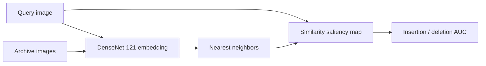
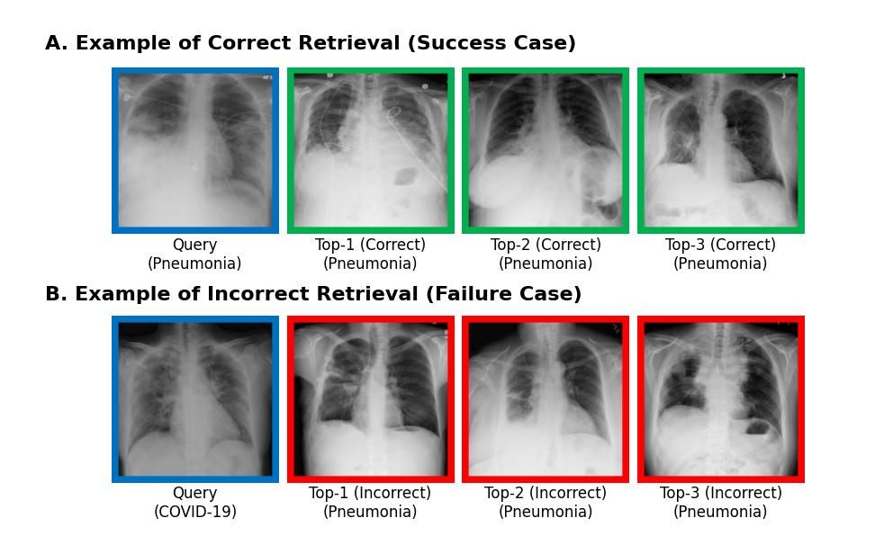
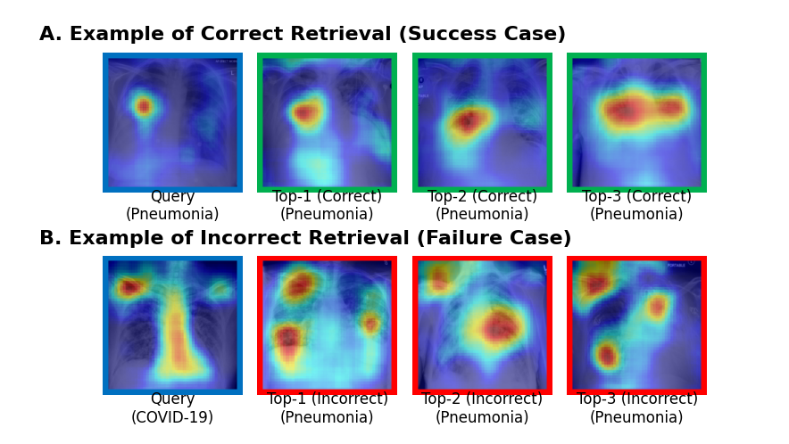
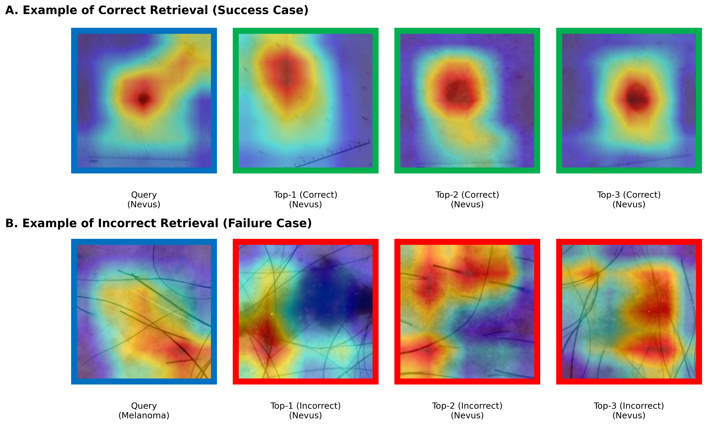

# X-MIR Reproduction

An evidence-driven reproduction of explainable medical image retrieval on chest X-rays and dermoscopic images.

Reproduction of Hu et al., [X-MIR: EXplainable Medical Image Retrieval](https://openaccess.thecvf.com/content/WACV2022/html/Hu_X-MIR_EXplainable_Medical_Image_Retrieval_WACV_2022_paper.html) (WACV 2022). Original code © Kitware, Inc. ([BSD 3-Clause](LICENSE)); [original repository](https://gitlab.kitware.com/brianhhu/x-mir).

## Highlights

- Retrieval artifacts report 86.9% mAP on the available COVIDx result file and 54.2% on ISIC 2017.
- The stored `acc` metric is recall at K (R@K): R@1/R@5 are 89.6%/96.4% for COVIDx and 69.3%/92.2% for ISIC 2017. It is not P@K.
- SimAtt insertion/deletion means are 81.6%/77.4% across 101 COVIDx query images and 76.8%/62.3% across 249 ISIC query images.
- The COVIDx COVID-19 class is the limiting class: 28.9% mAP over 65 of 1,544 test images.

## Overview

X-MIR retrieves archive images whose learned embeddings are close to a query embedding. In a medical setting, a neighbor alone is not enough: a clinician needs evidence for which image regions drove similarity. This reproduction covers DenseNet-121 retrieval, triplet-loss training, similarity saliency maps, and insertion/deletion evaluation on COVIDx chest X-rays and ISIC 2017 dermoscopic lesions.

The checked artifacts reproduce the repository's evaluation pipeline. They do not establish clinical validity and are not a diagnostic system.

## Method

The retrieval backbone is DenseNet-121. For chest X-rays, training can initialize it from the included CheXNet-derived `model.pt`; ISIC uses the same architecture without that chest-X-ray initialization. Embeddings are L2-normalized. An optional linear projection layer is controlled by `--embedding-dim`.

Training uses a margin triplet loss (`margin=0.2` by default). `PKSampler` draws `p` classes and `k` samples per class (defaults: 3 × 16), and the default loss averages all positive triplets in a batch. The code also contains a batch-hard implementation, but the training entry point uses batch-all mining.



`explanations.py` implements occlusion-based SBSM, attention-based SimAtt, and activation-mapping SimCAM, plus related variants. The saved evaluation JSON files are named `*_simatt`, so the XAI table below reports SimAtt artifacts. Insertion starts from a blurred retrieved image and restores the most salient pixels; a higher AUC is preferred. Deletion removes those pixels from the retrieved image; a lower AUC is preferred. Both measure cosine similarity to the query embedding.

## Datasets

COVIDx uses three labels: normal, pneumonia, and COVID-19. The repository includes two different test lists. The retrieval artifact has 1,544 labels matching `test_split.txt`, not the 300-image balanced `test_COVIDx4.txt` used by the original paper.

| Dataset / split file | Images | Class distribution |
|---|---:|---|
| COVIDx `train_split.txt` | 45,624 | normal 7,966; pneumonia 5,474; COVID-19 32,184 |
| COVIDx `test_split.txt` | 1,544 | normal 885; pneumonia 594; COVID-19 65 |
| COVIDx `test_COVIDx4.txt` | 300 | normal 100; pneumonia 100; COVID-19 100 |
| ISIC `ISIC-2017_Training_Part3_GroundTruth.csv` | 2,000 | nevus 1,372; melanoma 374; seborrheic keratosis 254 |
| ISIC `ISIC-2017_Test_v2_Part3_GroundTruth_balanced.csv` | 270 | nevus 90; melanoma 90; seborrheic keratosis 90 |

Use the source datasets' terms and access conditions. `create_COVIDx.ipynb` documents the COVIDx assembly and writes `train_split.txt` and `test_split.txt`; it expects the upstream data sources and should be reviewed before running. ISIC uses the two included ground-truth CSV files.

## Results

All retrieval numbers below come directly from the saved `.npz` files. mAP and P@K are stored in `mAP` and `pr`; R@K is stored in `acc`. Per-class values are recomputed from `dists` and `labels` with the same AP/P@K procedure as `test.py`/`get_metrics.py`. Values are percentages and rounded to one decimal.

| Dataset | mAP | P@1 | P@5 | R@1 | R@5 | Paper |
|---|---:|---:|---:|---:|---:|---|
| COVIDx | 86.9 | 89.6 | 89.0 | 89.6 | 96.4 | DenseNet-121: 87.6 / 90.0 / 89.9 |
| ISIC 2017 | 54.2 | 69.3 | 64.1 | 69.3 | 92.2 | TODO: confirm matching paper configuration |

Paper cells list mAP / P@1 / P@5 from Table 1 of Hu et al. The COVIDx paper result used a 300-image class-balanced test set and a three-initialization average, so it is not a like-for-like comparison with this 1,544-image artifact. The ISIC artifact's checkpoint name and saved embedding shape disagree; no paper row is assigned until that configuration is confirmed.

### COVIDx by class

| Class | Images | mAP | P@1 | P@5 |
|---|---:|---:|---:|---:|
| Normal | 885 | 90.4 | 92.7 | 92.2 |
| Pneumonia | 594 | 88.0 | 88.7 | 88.6 |
| COVID-19 | 65 | 28.9 | 55.4 | 50.5 |

### ISIC 2017 by class

| Class | Images | mAP | P@1 | P@5 |
|---|---:|---:|---:|---:|
| Nevus | 90 | 52.4 | 73.3 | 61.6 |
| Seborrheic keratosis | 90 | 58.6 | 68.9 | 69.1 |
| Melanoma | 90 | 51.6 | 65.6 | 61.6 |

### Explainability

| Dataset | Query images evaluated | Insertion AUC ↑ | Deletion AUC ↓ |
|---|---:|---:|---:|
| COVIDx | 101 | 81.6 | 77.4 |
| ISIC 2017 | 249 | 76.8 | 62.3 |

The means are calculated directly from every insertion/deletion score pair in the JSON artifacts: 197 pairs across 101 COVIDx query keys and 249 pairs across 249 ISIC query keys. They are not copied from the older reports.

<p align="center">
  
</p>

COVIDx retrieval examples. The top row shows a pneumonia query with three same-class neighbors. The bottom row shows a COVID-19 query whose three shown neighbors are pneumonia.

<p align="center">
  
</p>

COVIDx SimAtt overlays for the same success and failure examples. These maps are qualitative evidence only; bright regions indicate higher saliency, not pathology ground truth.

<p align="center">
  
</p>

ISIC retrieval and saliency examples. The upper case retrieves nevi for a nevus query; the lower melanoma query retrieves nevi. The overlays show that lesion-centered saliency can occur in both cases.

## Analysis

COVIDx is high overall in the stored artifact, but the class average hides a failure mode. COVID-19 is 65/1,544 images (4.2%) and has 28.9% mAP. Its visual overlap with pneumonia is consistent with the failure example, but this repository does not isolate causality. The imbalance and competing pneumonia features are plausible contributors, not a confirmed explanation.

Compared with the paper's DenseNet-121 COVID-19 row, the stored artifact is lower by 0.7 mAP points, 0.4 P@1 points, and 0.9 P@5 points. That numerical difference should not be interpreted as a clean reproduction gap because the test populations and aggregation differ. The paper's ISIC rows range from 56.0–61.6 mAP, 64.7–69.6 P@1, and 62.4–69.2 P@5 across configurations; the matching configuration here is unresolved.

The ISIC SimAtt artifact has a 14.6-point insertion–deletion separation (76.8 vs. 62.3). COVIDx has a smaller 4.2-point separation (81.6 vs. 77.4). A larger separation is compatible with salient pixels affecting similarity more selectively, but neither metric verifies medical correctness. The current saliency evaluation configuration also prevents a firm cross-dataset conclusion; see the notes below.

## Reproduction Notes

### Environment and changes from the original baseline

- The original README records Ubuntu 18.04 and PyTorch 1.9.0. `requirement.txt` pins `torch==1.9.0` and `torchvision==0.10.0`; the Python version used to create the supplied artifacts is not recorded.
- The paper reports a single NVIDIA Titan Xp GPU in a GPU cluster. This fork adds `utils/device.py`, which prefers CUDA, then Apple MPS, then CPU. CPU execution is possible but saliency evaluation is slow.
- Fixed portability failures in the training, testing, and saliency paths: direct CUDA device selection was replaced with `get_device()`, checkpoints can load with `map_location='cpu'`, and saliency output uses `os.path.basename` with directory creation. Relative defaults were added for train/test data.
- The repository additionally contains splits, checkpoints, result artifacts, visualization images, result-report Markdown files, and helper scripts. These changes are visible in `git diff 8d097e6..HEAD`.

### TODO: confirm

- `results/isic_densenet121_embed_256_seed_0_epoch_20_ckpt.npz` stores 1,024-D embeddings, although its filename and checkpoint filename say `embed_256`. Do not map it to a paper configuration or invoke `--embedding-dim 256` until the checkpoint architecture is verified.
- `results/covid_densenet121_seed_0_epoch_1_ckpt.npz` is named `epoch_1`, while the original README examples discuss an epoch-20 checkpoint. TODO: confirm its training duration and provenance.
- The COVIDx retrieval artifact matches `test_split.txt` (1,544 images), while the original-paper split is `test_COVIDx4.txt` (300 balanced images). TODO: confirm which split was intended for the reproduction comparison.
- `evaluate_saliency.py` sets `dataset_type = 'covid'` but loads the ISIC checkpoint path, contains absolute Windows paths, and has no command-line interface. TODO: confirm the model/data pairing that produced both JSON artifacts before rerunning or comparing their AUCs.
- `compute_saliency.py` still has a source-specific default test-data path, although explicit CLI arguments override it. TODO: remove the default before treating the workflow as portable.

The author README is retained unchanged at [`docs/ORIGINAL_README.md`](docs/ORIGINAL_README.md).

## Getting Started

### Install

```bash
python -m venv .venv
# Activate the environment for your shell.
python -m pip install --upgrade pip
python -m pip install -r requirement.txt
```

Install a PyTorch build compatible with your OS, Python version, and CUDA runtime if the pinned wheel does not cover your platform.

### Prepare data

1. Obtain COVIDx and ISIC 2017 from their original sources.
2. Put COVIDx images under `<COVIDX_ROOT>/train` and `<COVIDX_ROOT>/test`, with paths matching the selected split file.
3. Put ISIC images under `<ISIC_ROOT>/ISIC-2017_Training_Data` and `<ISIC_ROOT>/ISIC-2017_Test_v2_Data`.
4. Use the included split/CSV files, or generate and document a new COVIDx split via `create_COVIDx.ipynb`.

### Train

```bash
# COVIDx baseline; optionally initialize from the included CheXNet-derived weights.
python train.py --dataset covid --dataset-dir <COVIDX_ROOT> \
  --train-image-list train_split.txt --test-image-list test_split.txt \
  --resume model.pt --save-dir checkpoints

# ISIC; add --embedding-dim 256 only when training a new 256-D model.
python train.py --dataset isic --dataset-dir <ISIC_ROOT> \
  --train-image-list ISIC-2017_Training_Part3_GroundTruth.csv \
  --test-image-list ISIC-2017_Test_v2_Part3_GroundTruth_balanced.csv \
  --save-dir checkpoints
```

### Evaluate retrieval

```bash
# COVIDx
python test.py --dataset covid --test-dataset-dir <COVIDX_ROOT>/test \
  --test-image-list test_split.txt --resume <COVIDX_CHECKPOINT> --save-dir results

# ISIC: only add --embedding-dim after confirming the checkpoint architecture.
python test.py --dataset isic --test-dataset-dir <ISIC_ROOT>/ISIC-2017_Test_v2_Data \
  --test-image-list ISIC-2017_Test_v2_Part3_GroundTruth_balanced.csv \
  --resume <ISIC_CHECKPOINT> --save-dir results
```

### Generate saliency maps

```bash
python compute_saliency.py --dataset covid --test-dataset-dir <COVIDX_ROOT>/test \
  --test-image-list test_split.txt --results results/<RESULTS_FILE>.npz \
  --resume <COVIDX_CHECKPOINT> --explainer simatt --topk 5 \
  --save-dir saliency/covidx
```

Use `--self-saliency` to explain a query against itself. For ISIC, replace the dataset, image directory, list, results, and checkpoint arguments; add `--embedding-dim` only after resolving the checkpoint mismatch.

### Evaluate saliency

There is no portable command-line invocation for `evaluate_saliency.py` in the current revision. Its data paths, dataset selection, and model path are hard-coded and internally inconsistent. Do not copy those paths into a run command. Resolve the TODO above or refactor that script to accept CLI arguments before regenerating insertion/deletion JSON files.

## Repository Structure

```text
.
├── train.py                  # Train DenseNet/ResNet embedding models with triplet loss
├── test.py                   # Evaluate retrieval and write .npz metrics/artifacts
├── model.py                  # DenseNet-121 and ResNet-50 embedding definitions
├── loss.py                   # Batch-all and batch-hard triplet losses
├── sampler.py                # P×K class-balanced batch sampler
├── read_data.py              # COVIDx and ISIC dataset readers
├── explanations.py           # Similarity saliency implementations
├── compute_saliency.py       # Generate saliency maps from retrieval outputs
├── evaluate_saliency.py      # Insertion/deletion implementation; needs portability work
├── evaluation.py             # Causal-metric AUC utilities
├── results/                  # Saved retrieval embeddings, distances, and metrics
├── checkpoints/              # Supplied/reproduced checkpoint artifacts
├── visualize/                # Retrieval and saliency figures used above
├── create_COVIDx.ipynb       # COVIDx data assembly and split notebook
├── docs/ORIGINAL_README.md   # Preserved upstream README
└── requirement.txt           # Python dependency constraints
```

## Future Work

- Add hard-negative mining and compare it with batch-all triplet loss.
- Balance COVIDx training and evaluation, then report class-stratified uncertainty.
- Evaluate contrastive-learning objectives under the same splits and protocol.
- Establish CLIP and DINOv2 embedding baselines with the same retrieval and saliency metrics.

## Team

[name] — [role]

## Acknowledgment and License

This work builds on the original X-MIR code and paper by Brian Hu, Bhavan Vasu, and Anthony Hoogs. The upstream acknowledgment describes support from the Air Force Research Laboratory and DARPA under Cooperative Agreement N66001-17-2-4028. See the preserved [original README](docs/ORIGINAL_README.md) for the complete statement and disclaimer.

This repository is distributed under the [BSD 3-Clause License](LICENSE). Original code copyright © Kitware, Inc.
